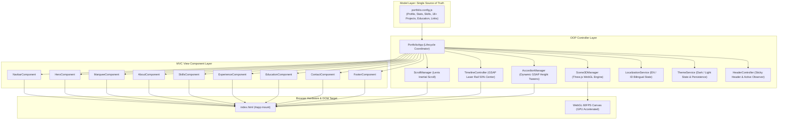

# 🏛️ Munardi — Enterprise-Grade 3D WebGL Portfolio & Architecture Showcase

[](https://munardi15.github.io/portofolio-munardi/)
[](https://vitejs.dev/)
[](https://threejs.org/)
[](https://greensock.com/)
[](https://github.com/darkroomengineering/lenis)
[](https://en.wikipedia.org/wiki/Model%E2%80%93view%E2%80%93controller)
[](https://nodejs.org/api/test.html)

A high-performance, institutional portfolio engineered with **Clean Architecture, OOP Design Patterns, and MVC Separation of Concerns**. Demonstrating 7+ years of senior-level software engineering across mission-critical core banking systems, high-throughput bulk ETL pipelines, and spatial 3D WebGL visual computing.

Designed from the ground up to be **100% modular and reusable** by other software engineers, quant developers, and tech leads. Anyone who clones this repo can run it locally in seconds and adapt it to their own career history.

---

## ⚡ Quick Start (Run Locally in 60 Seconds)

### Prerequisites
* **Node.js**: `v18.0.0` or higher (`v20+` / `v22+` recommended)
* **npm**: `v9.0.0` or higher (or `pnpm` / `yarn` / `bun`)
* **Browser**: Modern browser with WebGL hardware acceleration enabled (Chrome, Safari, Firefox, Edge)

### Installation & Execution
```bash
# 1. Clone the repository
git clone https://github.com/Munardi15/portofolio-munardi.git
cd portofolio-munardi

# 2. Install dependencies (Three.js, GSAP, Lenis, Vite)
npm install

# 3. Start local development server with Hot Module Replacement (HMR)
npm run dev
```

Visit [`http://localhost:5173`](http://localhost:5173) in your browser.

### Other Useful Commands
```bash
# Run automated schema and component unit tests
npm test

# Build production-ready optimized bundle into dist/
npm run build

# Preview production build locally on http://localhost:4173
npm run preview
```

---

## 📐 System Architecture & Design Philosophy

This codebase strictly adheres to **SOLID principles, DRY, and Clean Architecture**, completely decoupling content/configuration from presentation rendering and execution controllers.



### Key Engineering Patterns
1. **Hierarchical 3D Scene Graph**: Solves gimbal lock and scroll jitter by isolating transforms into nested pivots:
   $$\text{Scene} \rightarrow \text{scrollPivot (Z/Y depth)} \rightarrow \text{mousePivot (gyro tilt)} \rightarrow \text{coreGroup (spin & meshes)}$$
2. **Adaptive GSAP Accordion Tweens**: Eliminates CSS `max-height` easing defects by measuring natural DOM heights at runtime, executing butter-smooth cubic bezier transitions (`power3.out` / `power3.inOut`) and cascading project cards with staggered reveals.
3. **Focal Center Illumination**: Timeline laser head and active company node triggers align precisely at the eye's central reading zone (`top 50%` / `start: 'top 60%', end: 'bottom 25%'`).
4. **Zero-Dependency Native Unit Tests**: Powered by the built-in Node.js test runner (`node:test` + `node:assert`), verifying schema integrity, bilingual synchronization, and component outputs in under 70ms.

---

## 🗂️ Project Directory Structure

```text
munardi-portfolio/
├── .github/
│   └── workflows/
│       └── deploy.yml            # Automated CI/CD pipeline to GitHub Pages
├── public/                       # Static public assets (All icons, favicons & resumes)
│   ├── apple-touch-icon.png
│   ├── favicon-16x16.png
│   ├── favicon-32x32.png
│   ├── favicon.ico
│   ├── favicon.svg               # Amber {A} brand icon
│   ├── MUNARDI-CV_SoftwareEngineer.pdf
│   ├── MUNARDI-CV_BackendEngineer.pdf
│   ├── MUNARDI-CV_FullStackDeveloper.pdf
│   └── .nojekyll
├── src/
│   ├── config/
│   │   └── portfolio.config.js   # 🎯 SINGLE SOURCE OF TRUTH (All your data lives here)
│   ├── core/                     # ⚙️ OOP Controllers & Services
│   │   ├── Scene3DManager.js     # Three.js 60fps WebGL lifecycle engine
│   │   ├── ScrollManager.js      # Lenis smooth inertial scroll & GSAP ticker sync
│   │   ├── TimelineController.js # Experience laser rail & 50% center focal illumination
│   │   ├── AccordionManager.js   # Dynamic height GSAP tweens & card staggers
│   │   ├── LocalizationService.js# EN/ID bilingual state manager & event bus
│   │   ├── ThemeService.js       # Dark/Light theme manager with persistence
│   │   └── HeaderController.js   # Sticky header & ScrollTrigger active section observer
│   ├── components/               # 🎨 Pure MVC View Renderers
│   │   ├── NavbarComponent.js
│   │   ├── HeroComponent.js
│   │   ├── MarqueeComponent.js
│   │   ├── AboutComponent.js
│   │   ├── SkillsComponent.js
│   │   ├── ExperienceComponent.js
│   │   ├── EducationComponent.js
│   │   ├── ContactComponent.js
│   │   └── FooterComponent.js
│   ├── styles/
│   │   └── style.css             # Obsidian Spatial Design System & responsive tokens
│   ├── PortfolioApp.js           # Main application controller & coordinator
│   └── main.js                   # Client entry point
├── tests/                        # 🧪 Automated Test Suite
│   ├── config.test.js            # Configuration schema & data integrity assertions
│   └── components.test.js        # View renderers output assertions
├── index.html                    # Lightweight semantic host document (#app)
├── vite.config.js                # Code splitting (Three.js & GSAP vendor chunks)
└── package.json                  # Scripts & metadata
```

---

## 🛠️ How to Customize for Your Own Portfolio

You can adapt this entire portfolio for your own CV and projects without touching Three.js, GSAP, or CSS.

### 1. Edit `src/config/portfolio.config.js`
Open `src/config/portfolio.config.js` and modify your data:

```javascript
export const portfolioConfig = {
  personal: {
    name: 'Your Name',
    rolePrimary: 'Senior Software Engineer',
    roleBadge: 'Distributed Systems & Cloud Architecture',
    pitch: {
      en: 'Architecting scalable cloud systems and resilient data pipelines...',
      id: 'Merekayasa sistem cloud skalabel dan pipeline data andal...'
    },
    contact: {
      whatsapp: '+62 812-xxxx-xxxx',
      email: 'youremail@domain.com',
      linkedin: 'https://linkedin.com/in/yourprofile',
      github: 'https://github.com/yourusername'
    },
    cvDownloads: [
      { label: 'Software Engineer (PDF)', file: './YOUR_CV.pdf', primary: true }
    ]
  },
  // Update your skills categories, work experiences, project drawers, and education!
};
```

### 2. Put your CV & Favicons in `public/`
Drop your resume PDF files into `public/` and match the filenames in `portfolio.config.js`.

### 3. Test and Deploy
```bash
# Verify your data schema and components
npm test

# Build and verify bundle
npm run build
```

---

## 🧪 Automated Testing

This repository includes automated tests running on the native Node.js test runner:

```bash
npm test
```

Sample output:
```text
▶ MVC Component Renderers Integrity
  ✔ NavbarComponent renders header and navigation links (0.43ms)
  ✔ HeroComponent renders canvas, name, and CTA buttons (0.18ms)
  ✔ MarqueeComponent renders dual velocity tracks (0.11ms)
  ✔ AboutComponent renders bento grid and stats (0.12ms)
  ✔ SkillsComponent renders 5 skill cards (0.13ms)
  ✔ ExperienceComponent renders laser rail and 5 company blocks (1.00ms)
  ✔ EducationComponent renders degrees and Mercu Buana (0.22ms)
  ✔ ContactComponent renders contact channels and CV deck (0.27ms)
  ✔ FooterComponent renders copyright and back to top button (0.90ms)
✔ MVC Component Renderers Integrity (4.99ms)

▶ Portfolio Configuration Schema & Data Integrity
  ✔ has all required top-level sections (0.57ms)
  ✔ personal information is complete and valid (0.13ms)
  ✔ experiences contain all 5 verified companies and 18+ projects (0.10ms)
  ✔ every project has complete bilingual fields and tags (0.12ms)
  ✔ skills contain all 5 architectural categories (0.08ms)
  ✔ education lists degree with GPA 3.71 Cum Laude (0.08ms)
✔ Portfolio Configuration Schema & Data Integrity (2.26ms)

ℹ tests 17 | pass 17 | fail 0 | duration_ms 68ms
```

---

## 🚢 CI/CD & Deployment

Deployments are automated via `.github/workflows/deploy.yml`. On every push to `main`:
1. Automated unit test suite runs.
2. Vite compiles production assets into `dist/`.
3. Assets are deployed to the `gh-pages` branch, serving the live site at `https://<username>.github.io/<repo>/`.

To enable GitHub Pages in your own forked repository:
1. Go to your repo on GitHub: **Settings** $\rightarrow$ **Pages**.
2. Under **Build and deployment** $\rightarrow$ **Source**, choose **Deploy from a branch**.
3. Select branch: `gh-pages` / folder: `/ (root)`.
4. Click **Save**.

---

## 🔧 Troubleshooting

| Issue | Resolution |
| :--- | :--- |
| **Port 5173 is already in use** | Run `npx vite --port 3000` to start on a different port. |
| **WebGL not rendering in browser** | Check browser settings and enable **Hardware Acceleration**. |
| **GitHub Pages 404 on assets** | Check `vite.config.js`: ensure `base: './'` is preserved so asset paths remain relative. |

---

## 👨‍💻 Author

**Munardi** — Senior Software Engineer
* **Email:** [dira20590@gmail.com](mailto:dira20590@gmail.com)
* **LinkedIn:** [linkedin.com/in/munardi](https://linkedin.com/in/munardi)
* **GitHub:** [@Munardi15](https://github.com/Munardi15)

---

## 📄 License
This project is open-source and available under the [MIT License](LICENSE).
